# Public Repository Topology

## Federated portfolio extension

The primary-account graph is now part of a six-account public federation. See [MULTI-ACCOUNT-TOPOLOGY.md](MULTI-ACCOUNT-TOPOLOGY.md), [ALT-ACCOUNT-ROSTER.md](ALT-ACCOUNT-ROSTER.md), and [cross-account relationships](data/cross-account-relationships.json). The federation distinguishes original projects, GitHub-confirmed forks, profiles, and a controlled test copy.

For the full narrative describing all portfolio domains, integration paths, cross-cutting principles, and private/public boundaries, see [SYSTEM-OVERVIEW.md](SYSTEM-OVERVIEW.md).

## Top-level map

The account's public work is best read as several connected project families, not as one monolithic application. Solid arrows below indicate relationships explicitly documented in public repository material. Dotted arrows represent conceptual alignment only.

```mermaid
flowchart TD
  ARCH["Archive engineering"]
  PUBLIC["Huffman-Public-Archive-Topology"]
  BLUE["repo-mesh-blueprint"]
  ENGINE["mesh-archivist-engine"]
  ARCH --> BLUE
  ARCH --> ENGINE
  PUBLIC -. "public inventory and projection" .-> BLUE
  PUBLIC -. "public inventory and projection" .-> ENGINE
  BLUE -. "architecture standard" .-> ENGINE

  HDI["Huffman-Defensive-Intelligence"]
  OIX["Open-Intelligence-Exchange"]
  SWARM["-Open-Swarm"]
  HAL["Halloween-OSINT-2026"]
  HCO["Huffman-Cyber-Observatory"]
  HDI --> OIX
  HDI --> SWARM
  HDI --> HAL
  HDI --> HCO

  OIF["Open-Intelligence-Fabric"]
  OIFR["OIF-Research-Observatory"]
  COG["OIF-Cognitive-Systems"]
  OIS["OI-Swarm-Intelligence"]
  COL["OIF-Collective-Intelligence"]
  CY["OIF-Cyber-Intelligence"]
  AIS["OIF-AI-Security"]
  SYS["OIF-Systems-Intelligence"]
  MOD["OIF-Model-Intelligence"]
  CONF["OIF-Conformance-Lab"]
  OIF --> OIFR
  OIF --> COG
  OIF --> OIS
  OIF --> COL
  OIF --> CY
  OIF --> AIS
  OIF --> SYS
  OIF --> MOD
  OIF --> CONF

  CAS["cas-xdp-supervisor"]
  POSIX["posix-containment-kit"]
  XDP["xdp-ingress-primitives"]
  THREAT["cas-threat-index"]
  CAS -. "component family" .-> POSIX
  CAS -. "component family" .-> XDP
  CAS -. "component family" .-> THREAT

  HP["Huffman-Protocol"]
  MASG["Multi-Agent-Swarm-Guardrails"]
  WORK["OpenWorkSpace"]
  REV["Huffman-Reverse-Intelligence"]
  HP -. "interoperability/conformance alignment" .-> OIX
  HP -. "agent safety alignment" .-> MASG
  WORK -. "workspace/agent ecosystem" .-> SWARM
  REV -. "research adjacency" .-> HCO
```

## Relationship evidence

### Documented integration

`Huffman-Defensive-Intelligence` publicly identifies the following projects as integrated ecosystem components: Open Intelligence Exchange, Open-Swarm, Halloween OSINT, and Huffman Cyber Observatory. Its branch history also includes named integration phases for OIX, Open-Swarm, Halloween evidence, and cyber evidence. This is stronger than a name-based association, but it does not mean every phase is merged or every integration path is production-ready.

### Shared foundation / project family

`Open-Intelligence-Fabric` describes standards, terminology, taxonomy, schemas, resource contracts, and interoperability as its foundation. The OIF-prefixed repositories and `OI-Swarm-Intelligence` are mapped as its research family. This map records the stated family relationship; it does not claim that each repository imports or executes code from the foundation.

### CAS-XDP defensive component family

`cas-xdp-supervisor`, `posix-containment-kit`, `xdp-ingress-primitives`, and `cas-threat-index` are mapped as a defensive control/component family based on their public purposes. The dotted edges are conceptual until a machine-readable dependency manifest or explicit integration contract verifies them.

### Protocol and safety adjacency

`Huffman-Protocol`, `Open-Intelligence-Exchange`, and `Multi-Agent-Swarm-Guardrails` occupy neighboring interoperability and agent-safety concerns. They are not represented as interchangeable protocols. Their exact wire-level contracts and implementation dependencies must be read from their own specifications.

## Nodes without asserted edges

The archive, OSINT, and research projects `Protocol-Helios`, `Project_Lazarus_OSINT`, `Cui-Bono-Audit-Tool`, `Curated-Modern-OSINT-Tools`, `Project-Helios-US-Archive`, `Happy-Halloween-2026`, `Halloween-2026OSINT`, `Halloween2-OSINT-2026`, and `Coming-Soon-Project-AVI` remain individually cataloged. No runtime dependency is asserted solely because projects share a theme or campaign.

## What this topology does not claim

- It is not a deployment diagram or live service map.
- It does not prove network connectivity, runtime orchestration, or data exchange between all nodes.
- It does not infer private infrastructure from public names.
- It does not equate a branch name containing "integration" with a merged integration.
